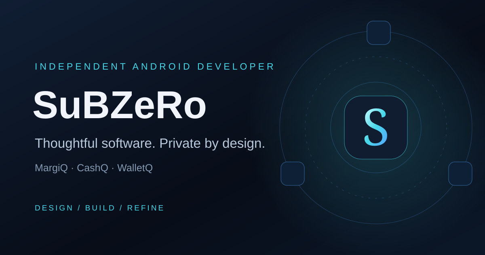

<div align="center">

  

  # SuBZeRo

  **Independent Android Developer**

  Thoughtful software. Private by design. Built with care.

  [](https://dr-subzero.github.io/)
  [](https://github.com/Dr-SuBZeRo)

</div>

---

## About this website

This repository contains the official portfolio website of **SuBZeRo**, an independent Android developer focused on building practical applications with thoughtful interfaces, dependable engineering and respect for user privacy.

The site presents the developer profile, current applications, engineering principles and technology choices. **SuBZeRo is the developer identity**; each application keeps its own name and identity.

**Live website:** https://dr-subzero.github.io/

## Current applications

The portfolio currently highlights these three projects:

| Application | What it does | Project |
|---|---|---|
| **MargiQ** | Profit, pricing and margin calculations | [Repository](https://github.com/Dr-SuBZeRo/MargiQ) · [Latest release](https://github.com/Dr-SuBZeRo/MargiQ/releases/latest) |
| **CashQ** | Indian rupee cash counting and session management | [Repository](https://github.com/Dr-SuBZeRo/CashQ) |
| **WalletQ** | Personal money management | [Repository](https://github.com/Dr-SuBZeRo/WalletQ) |

Project availability and development status can change. Check each repository for the current source code, release information and roadmap.

## Website features

- **Developer portfolio** — introduction, profile and direct GitHub links.
- **Application showcase** — dedicated summaries and repository links for the current projects.
- **Animated hero visual** — profile image at the centre, with application icons following animated orbital paths.
- **Engineering principles** — privacy, offline-minded design, accessibility and transparent development.
- **Technology overview** — tools and engineering practices used across projects.
- **Responsive navigation** — desktop navigation and a collapsible mobile menu.
- **Motion accessibility** — respects the visitor's reduced-motion preference.
- **Search and sharing metadata** — page description, social preview and structured developer information.

## Design direction

The website uses a dark navy visual foundation with cyan and blue accents, clear typography, restrained glow effects and responsive layouts. The goal is a professional developer portfolio that works well on both mobile and desktop screens.

The profile image and application artwork are loaded from GitHub-hosted assets. Typography is served through Google Fonts.

## Technology

This is a lightweight static website built with:

- HTML5 for semantic page structure.
- CSS for layout, responsive behaviour, visual effects and animations.
- Vanilla JavaScript for mobile navigation and scroll-based reveal effects.
- GitHub Pages for hosting and deployment.

There is no frontend framework, application backend, database or build system required for the website.

## Repository structure

```text
.
├── index.html                 # Main developer portfolio
├── privacy.html               # Website privacy notice
├── assets/
│   ├── favicon.svg            # Browser and bookmark icon
│   └── social-preview.svg     # Link-sharing preview artwork
├── LICENSE                    # Website source licence
└── README.md                  # Project documentation
```

## Run locally

No package installation or compilation is required.

1. Clone the repository:

   ```bash
   git clone https://github.com/Dr-SuBZeRo/Dr-SuBZeRo.github.io.git
   cd Dr-SuBZeRo.github.io
   ```

2. Start a local static server (Python 3):

   ```bash
   python -m http.server 8000
   ```

3. Open **http://localhost:8000** in your browser.

You can also open `index.html directly, but a local server is preferable when checking page behaviour.

## Deployment

The site is published using GitHub Pages.

For branch-based deployment:

1. Open the repository's **Settings → Pages**.
2. Under **Build and deployment**, select **Deploy from a branch**.
3. Select the `main` branch and the `/(root)` folder.
4. Save the settings and wait for the deployment to finish.
5. Open the published site and check the result on mobile and desktop.

**Live URL:** https://dr-subzero.github.io/

See the [GitHub Pages documentation](https://docs.github.com/en/pages) for hosting and deployment details.

## Privacy

The website is a static portfolio and does not provide user accounts, a database or a server-side application. This repository does not intentionally add advertising, analytics SDKs or tracking scripts.

Some presentation assets and fonts are requested from third-party hosts, including GitHub and Google Fonts. Those services may receive normal connection information when a visitor's browser loads those resources. GitHub Pages hosting may also process technical request information under GitHub's policies.

Read the [website privacy notice](privacy.html).

> The website privacy notice applies to this portfolio only. Each Android application should publish its own accurate privacy policy based on the data it actually handles before distribution.

## Feedback

Found an issue or have an improvement to suggest?

- [Report a website issue](https://github.com/Dr-SuBZeRo/Dr-SuBZeRo.github.io/issues)
- [Browse the source code](https://github.com/Dr-SuBZeRo/Dr-SuBZeRo.github.io)
- [Visit the developer profile](https://github.com/Dr-SuBZeRo)

## Licence

The website source is distributed under the [MIT License](LICENSE), unless otherwise noted. Third-party application icons, profile imagery, fonts and other referenced assets remain subject to their respective owners' terms and licences.

---

<div align="center">

  **SuBZeRo** · Independent Android Developer

  [Website](https://dr-subzero.github.io/) · [GitHub](https://github.com/Dr-SuBZeRo)

</div>
